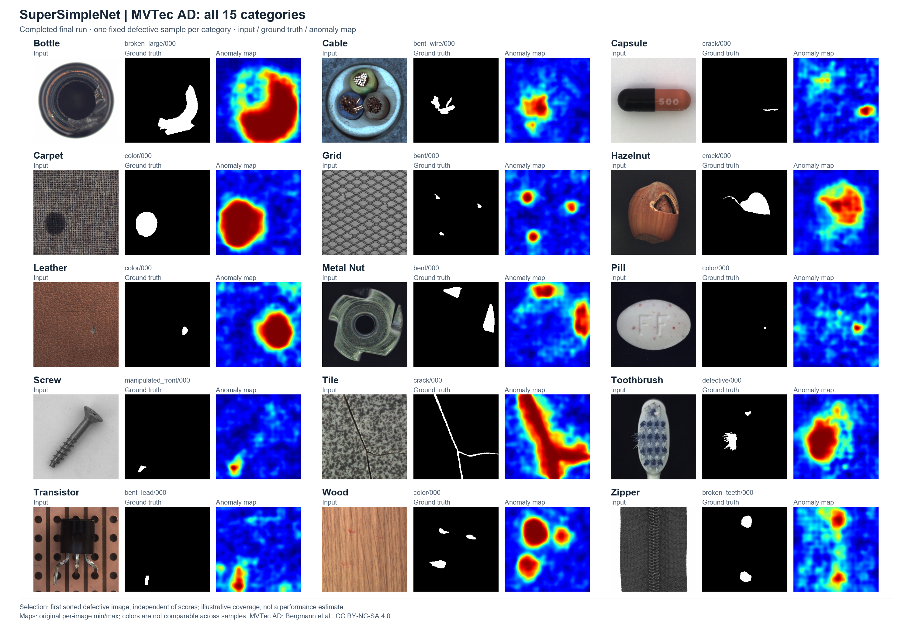

# Industrial Visual Anomaly Detection

**Normality modeling, defect localization, and reliable decisions.**

An ongoing research project investigating how models fitted to normal industrial images detect defects, localize anomalous regions, and support useful decisions. MVTec AD is the current published benchmark; the wider agenda includes additional industrial datasets, improved localization and future defect-type classification.

**12 completed method studies | 15 MVTec AD categories each | 180 category-level records**

The [published benchmark tables](results/summary.csv) now cover all 12 completed studies and 180 category-level records. These are not independent repetitions. Earlier records retain their original dates; EfficientAD-S and the literature catalog were integrated **26 October 2026**.

[Methods](methods/README.md) | [Results](results/README.md) | [Visual gallery](assets/GALLERY.md) | [Literature catalog](literature/README.md)

  

*SuperSimpleNet across all 15 MVTec AD categories: the recorded first sorted defective sample per category, selected independently of scores. Maps use per-image scales; these examples do not estimate general performance. [Full-resolution figure](assets/figures/supersimplenet_all15.png) · [Selection, provenance and MVTec AD attribution](assets/README.md#all-category-supersimplenet-overview).*

## Methods and benchmarking

| Approach | Completed method guides |
|---|---|
| Normal-feature memory and distributions | [PatchCore](methods/patchcore/README.md), [PaDiM](methods/padim/README.md) |
| Feature reconstruction and distillation | [DFR](methods/dfr/README.md), [RD4AD](methods/rd4ad/README.md) |
| Self-supervised patch representations | [PatchSVDD](methods/patchsvdd/README.md) |
| Generative reconstruction and latent discrepancy | [AnoGAN adaptation](methods/anogan/README.md), [GANomaly](methods/ganomaly/README.md), [Skip-GANomaly](methods/skip_ganomaly/README.md) |
| Learning with synthetic anomalies | [SimpleNet](methods/simplenet/README.md), [SuperSimpleNet, JIMS extension](methods/supersimplenet/README.md), [DRAEM](methods/draem/README.md) |
| Efficient teacher-student and autoencoder | [EfficientAD-S through Anomalib](methods/efficientad_s_anomalib/README.md) |

Guides distinguish published methods, local implementations and historical diagnostics. [Full results](results/README.md) retain category measurements and protocol identifiers. **Different preprocessing, checkpoint selection, scoring and PRO/AUPRO definitions preclude a directly comparable leaderboard.** Completed execution does not establish paper reproduction.

[EfficientAD-S](methods/efficientad_s_anomalib/README.md) now has bundled configuration, source and 15-category result records. Its native-resolution evaluation and Imagenette auxiliary data remain explicit protocol distinctions.

## Key research findings

- **Ranking and thresholded decisions differ.** Under the common DFR/RD4AD evaluator, RD4AD has higher category-macro pixel AUROC (**97.78% vs 95.25%**) but lower pixel F1 (**15.04% vs 41.56%**) at the specified training-normal quantile rule. This observed threshold-transfer result is not a general ranking of architectures. [Evidence](results/common_evaluation/report.md).
- **Calibration trades coverage for precision.** In the PaDiM Bottle holdout study, q99.5 to q99.9 raises pooled Dice from **64.41% to 71.42%**, while recall falls from **97.99% to 92.43%**. Prior test inspection makes this sensitivity analysis, not independently validated threshold selection. [Recorded measurements](results/calibration/padim_bottle/metrics.csv).
- **False-positive analysis requires controlled interventions.** DFR alignment and resolution ablations examine mask area alongside ranking. Native128 changes aggregation and PCA capacity together; its effects cannot be attributed solely to output resolution. [Ablations and failure analyses](results/ADDITIONAL_STUDIES.md).
- **Evaluation behavior affects reliability.** GANomaly's best-test selection and persistent test BatchNorm updates affect reported scores. Later scoring variants and pretrained-weight evaluations remain separate. [Protocol distinctions](results/PROTOCOLS.md).

  

*Leather threshold-transfer example: maps have independent scales; white denotes predicted anomaly and cyan traces GT. This selected case is not representative sampling.*

The [gallery](assets/GALLERY.md) includes complementary localization, calibration and failure examples, including the [PatchSVDD Screw investigation](methods/patchsvdd/README.md). [Figure provenance](assets/figures/SOURCES.csv) records sources, hashes, selection and rendering.

## Repository guide

| Resource | Contents |
|---|---|
| [Methods](methods/README.md) | Architectures, local implementations, outcomes and limitations |
| [Experiments](experiments/README.md) | Registry, retained settings and evaluation protocols |
| [Results](results/README.md) | Benchmark tables, calibration, ablations and negative results |
| [Visual gallery](assets/GALLERY.md) | Coverage of all methods and figure-specific caveats |
| [Literature catalog](literature/README.md) | English workbook, method/dataset CSVs and preserved source information |
| [Third-party sources](third_party/README.md) | Repository references, revisions, local changes and licenses |

## Reproducibility and limitations

Published summaries describe single-seed studies; category macro averages are not uncertainty estimates. Test-dependent selection, test-updated state and prior test inspection remain explicit. Historical SimpleNet CPU selection differs from the newer fixed-final run. See the [evaluation protocols](experiments/PROTOCOLS.md).

Selected runners, patches and source records are retained, but historical revisions and complete modifications are sometimes missing. Raw datasets, large checkpoints and full research outputs are not bundled. Some references require the original workspace, and relocated training/inference has not been verified. [Reconstruction limits](third_party/RECONSTRUCTION_LIMITS.md) document these gaps; failed and partial diagnostics remain distinct from completed benchmarks.

## Future directions

Planned work includes cross-dataset evaluation, additional anomaly detection methods, sharper localization with fewer false positives, and efficiency comparisons under consistent hardware and timing scopes. Broader seed coverage and stronger calibration controls remain priorities. **Defect-type classification is a future research direction, not a completed benchmark capability.**

## References and attribution

Original papers and implementations are linked through the [method guides](methods/README.md) and [source catalog](third_party/SOURCES.csv). Upstream work remains credited to its authors; local adaptations are identified separately.

No blanket project license has been selected. Consult the [retained third-party license records](third_party/licenses/README.md) for their stated scope. Inclusion here does not grant new rights to upstream code, datasets or figures.
