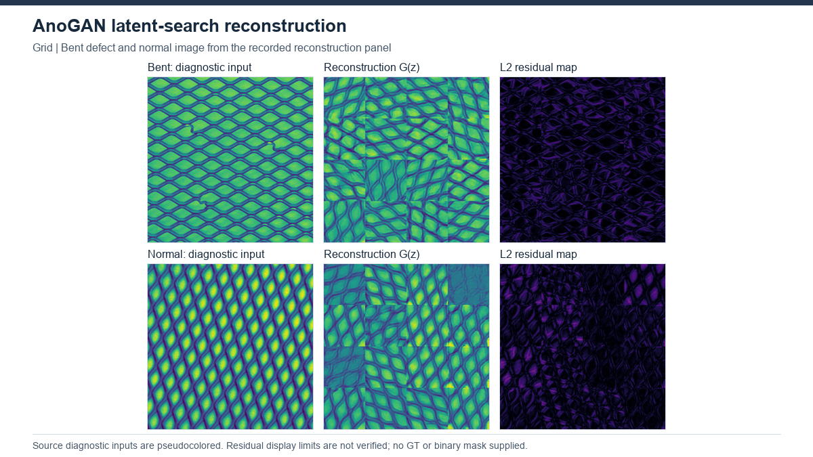

# AnoGAN — MVTec2019-based adaptation

[Project overview](../../README.md) · [Method index](../README.md) · [Research findings](../../docs/research_findings.md)

**Status: completed, 15 MVTec AD categories.** Results describe the recorded local implementation, not an exact paper reproduction.

## How it works

A GAN is fitted to normal images. For each test image or patch, a fresh latent vector is optimized until the generated image approximates the observation. The reconstruction residual supplies an anomaly map. This per-test optimization is fundamentally different from a single feed-forward detector.

**Architecture:** Normal images → DCGAN generator/discriminator training. Test patch → iterative latent search using pixel/feature matching → generated reconstruction → raw channel-L2 residual map.

## Our experiment

50 epochs; seed 0; latent 64; GAN Adam lr 0.0002; 300 latent steps per patch at lr 0.02; batch 64 for GAN fitting. Objects use128 px; textures use512 px with 16independent128 px searches. A 10%normal holdout is split before augmentation. Channel/augmentation/area choices are explicit local adaptations; Bottle is reused with its own provenance.

[Configuration evidence](../../experiments/configurations.json) · [Category results](../../results/benchmarks/anogan/results.csv)

## Results and what we learned

All 15 categories: Pixel AUROC 76.35%. An additional evaluation of max(saved raw L2 map) gives Image AUROC 67.54%, without retraining or latent search. It is not the original CVPR2019 thresholded classification metric. Category-specific normal/anomaly correctness is preserved separately.

Texture cases require16 searches per image and the recorded evaluation is much slower than one-search object cases. Pixel results vary substantially: Carpet 53.32% versus Hazelnut 90.25% in the recorded table. Residual maps and image alarms must be interpreted separately. The later max-map score does not establish a matched comparison with test-selected GANomaly.

## Visual evidence

Grid bent and good. Existing pseudocolored reconstruction/residual diagnostic; no GT/mask supplied. [All-method gallery](../../assets/GALLERY.md) and [figure provenance](../../assets/figures/SOURCES.csv) identify the original source, selection and scale. This illustration is not a matched-protocol comparison.

## Upstream and local work

[Original implementation](https://github.com/seungjunlee96/AnoGAN-pytorch) · [Paper](https://arxiv.org/abs/1703.05921) · [Recorded provenance](upstream.json) · [Local changes](CHANGES.md).

The downloaded PyTorch source and our MVTec2019 adaptation are not the same implementation; the adaptation also references [LeeDoYup/AnoGAN-tf](https://github.com/LeeDoYup/AnoGAN-tf).

Upstream model design is credited to its authors. Our contribution is the documented execution, adaptation and/or evaluation analysis described above. See the [protocol definitions](../../docs/evaluation_protocols.md) before cross-method comparisons. Relocated training/inference has not been verified.
