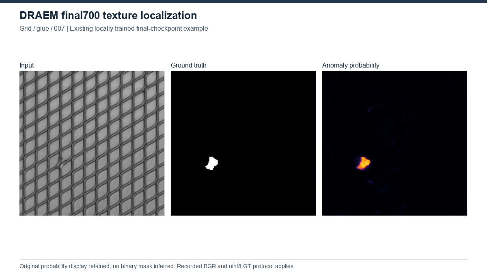

# DRAEM

[Project overview](../../README.md) | [Method index](../README.md)

**Status: completed local MVTec AD experiment, 15/15 categories.** The run status records completion at 2026-10-20 04:11:06 UTC. This guide distinguishes local final-700-epoch training from the separate evaluation of downloaded pretrained weights.

## Principle and architecture

DRAEM jointly trains a reconstruction network and a discriminative segmentation network. Synthetic defects are introduced into normal images using augmented DTD textures blended through Perlin masks. A reconstruction encoder-decoder predicts the clean normal image. A second encoder-decoder receives the corrupted image concatenated with its reconstruction (six channels) and predicts normal/anomalous pixel logits. Reconstruction and corrupted input therefore provide evidence for discriminative localization rather than using reconstruction error alone as the final anomaly score.

The recorded implementation uses ReconstructiveSubNetwork(3, 3, base_width=128) and DiscriminativeSubNetwork(6, 2, base_channels=64). Training minimizes MSE + SSIM + focal loss with unit coefficients; segmentation gradients also reach the reconstruction network. No image-classification head is trained.

At evaluation, softmax channel 1 is the pixel anomaly map. Pixel AUROC and AUPRO use this map; the image score is the maximum after 21x21 average pooling (stride 1, padding 10). No decision threshold is selected, so ranking results do not establish calibrated pass/fail performance.

## Recorded setup

| Item | Verified local record |
|---|---|
| Dataset | MVTec AD; separate model per category; training uses train/good only |
| Synthetic anomaly source | DTD r1.0.1 textures, three sampled imgaug transforms, Perlin mask threshold 0.5 |
| Input | OpenCV BGR, linear resize to 256x256, divided by 255 |
| Training | 700 epochs, batch 8, seed 1024, workers 0 |
| Optimizer | Adam, LR 1e-4, betas (0.9, 0.999), weight decay 0 |
| Schedule | Milestones 560 and 630, gamma 0.2 |
| Checkpoint | Fixed final700; no test-based model, epoch or threshold selection |
| Precision | AMP and TF32 disabled |
| Environment | Python 3.11.9, torch 2.5.1+cu121, NumPy 1.26.4, imgaug 0.4.0; NVIDIA RTX A4000 |

Training requires normal category images, DTD textures and both networks. The source dataset samples with replacement, so an epoch does not guarantee exactly one visit to each normal image. Defective test images and pixel masks are required for evaluation, not training. The saved train-only smoke record reports eight batch-8 steps and passed checks; this is separate from the completed 700-epoch studies.

[Local experiment wrapper](../../third_party/local_changes/draem/run_draem_experiment.py), [metric implementation](../../third_party/local_changes/draem/metrics.py), [source verification](../../third_party/records/draem/source_verification.json), and [source catalog](../../third_party/SOURCES.csv).

## Outcomes and limitations

All 15 CSV category rows match their metrics.json files. Each category has a complete status and a training summary recording 700 epochs with test_used=false. The equal-category macro values recomputed from the CSV agree with summary.json: **97.597 / 97.134 / 92.506%** for image AUROC / pixel AUROC / AUPRO@0.30, respectively.

| Category | Image AUROC (%) | Pixel AUROC (%) | AUPRO@0.30 (%) |
|---|---:|---:|---:|
| bottle | 95.317 | 99.040 | 96.840 |
| cable | 88.475 | 95.237 | 73.733 |
| capsule | 96.769 | 92.641 | 90.991 |
| carpet | 98.315 | 97.160 | 93.018 |
| grid | 99.833 | 99.566 | 98.617 |
| hazelnut | 100.000 | 99.718 | 97.904 |
| leather | 100.000 | 98.844 | 98.129 |
| metal_nut | 99.316 | 99.303 | 95.706 |
| pill | 98.418 | 98.211 | 92.652 |
| screw | 96.639 | 99.206 | 95.287 |
| tile | 100.000 | 99.260 | 98.023 |
| toothbrush | 100.000 | 99.047 | 92.936 |
| transistor | 90.875 | 84.085 | 75.235 |
| wood | 100.000 | 97.142 | 92.053 |
| zipper | 100.000 | 98.545 | 96.472 |

These are one-seed local results, not a claim of successful paper reproduction. The local protocol follows the selected official code: its 560/630 learning-rate milestones, gamma 0.2, augmentation and rotation behavior differ from the paper settings documented in the local protocol. Windows workers=0 also differs from the upstream training example.

The main results preserve the upstream mask preprocessing: linear resize followed by /255 and uint8 conversion, which truncates intermediate boundary values. Nearest-neighbor ground truth was not silently substituted. AUPRO@0.30 is an added local metric using 8-connected regions and global background FPR; it is not pixel AP. No test-optimal threshold or F1 is reported. Metrics from other guides may use different preprocessing and PRO implementations.

The separate pretrained_validation directory records completed evaluation of downloaded author weights and comparison with the original evaluator. It does not establish local training of those weights, and its values are not mixed into the table above. No checkpoint, inference output or training job was rerun for this guide.

### Evidence locations

The original workspace-relative records below are outside github_release and are not bundled by this documentation change:

- DRAEM_MVTec_all15_20261015/results.csv, summary.json and status.json.
- Per-category protocol.json, training_summary.json, status.json and metrics.json.
- DRAEM_MVTec_all15_20261015/protokol_TR.md, preflight/environment.json and preflight/smoke_checks.json.
- DRAEM_MVTec_all15_20261015/pretrained_validation/validation.json and our_metrics.json.

The [reconciliation evidence inventory](../RECONCILIATION_EVIDENCE.csv) records the inspected paths and SHA-256 values. Results have been transcribed from records, not independently re-evaluated.

## Sources and local work

[Original paper: DRAEM - A Discriminatively Trained Reconstruction Embedding for Surface Anomaly Detection](https://arxiv.org/abs/2108.07610), ICCV 2021; [original repository](https://github.com/VitjanZ/DRAEM); [recorded provenance](../../third_party/records/draem/upstream.json); [MIT license](../../third_party/licenses/draem/LICENSE).

Recorded commit: 2dbf67397ab5c10a1494e5ae70ab59a25d7c35ef. The local source-verification record covers seven upstream Python files; it is not a full reproduction certificate.

The local wrapper adds Windows-compatible execution, seed and environment recording, final-checkpoint evaluation, recovery-state saving and reporting. The added metrics.py supplies local evaluation metrics. A NumPy compatibility alias may be used for imgaug; the local protocol records it. Original network/loss/data-loader code and local additions are distinguished in the [third-party reconstruction notes](../../third_party/RECONSTRUCTION_LIMITS.md).

No new experiment was run for this documentation. Relocated execution is unverified.

## Visual evidence

Grid glue/007. Locally trained final700; original GT/preprocessing conventions retained. [All-method gallery](../../assets/GALLERY.md) and [figure provenance](../../assets/figures/SOURCES.csv) identify the original source, selection and scale. This illustration is not a matched-protocol comparison.

