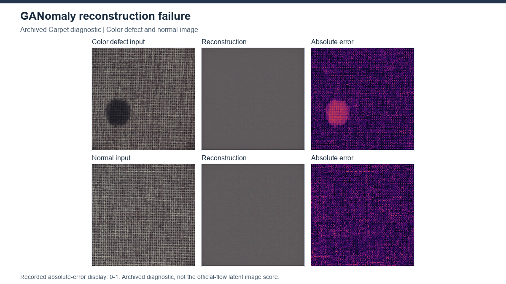

# GANomaly

[Project overview](../../README.md) · [Method index](../README.md) · [Research findings](../../docs/research_findings.md)

**Status: completed, 15 MVTec AD categories.** Results describe the recorded local implementation, not an exact paper reproduction.

## How it works

GANomaly trains an encoder–decoder–encoder generator together with a discriminator. It learns normal reconstructions while encouraging the input and reconstructed image to have similar latent representations. Their latent discrepancy supplies the image anomaly score.

**Architecture:** Input → encoder → latent z → decoder → reconstructed image → second encoder → latent z-hat. Training combines adversarial, reconstruction and latent-consistency objectives; testing scores the z/z-hat discrepancy.

## Our experiment

Official-flow study:25 epochs/category; seed 0; RGB 256 px; latent 100; batch 8; Adam lr 0.0002. Tests run in train mode, with BatchNorm test statistics persisting into subsequent epochs. The selected checkpoint maximizes test AUROC. Earlier eval-mode and reset/variant runs are separate archived experiments.

[Configuration evidence](../../results/benchmarks/ganomaly/protocol.json) · [Category results](../../results/benchmarks/ganomaly/results.csv)

## Results and what we learned

All 15 categories: final Image AUROC 57.62%; best-test-selected AUROC 69.17%. AP at the best-AUROC epoch is84.36%; test-threshold F1 is an oracle value, not a deployment estimate. Neither selected nor final score is independent of the recorded test-time BN flow. No native pixel benchmark is claimed.

Archived Carpet reconstructions fail to recover normal texture; Capsule normal/defect scores overlap. Batch statistics and test-image grouping materially change scores in the diagnostic study. Resolution/latent-size changes did not provide a general remedy. These observations identify failure modes but do not prove a single cause or authorize selecting a better test-inspected scoring rule.

## Visual evidence

Carpet color and good. Archived reconstruction failure; final official-flow qualitative coverage remains unverified. [All-method gallery](../../assets/GALLERY.md) and [figure provenance](../../assets/figures/SOURCES.csv) identify the original source, selection and scale. This illustration is not a matched-protocol comparison.

## Upstream and local work

[Original implementation](https://github.com/samet-akcay/ganomaly) · [Paper](https://arxiv.org/abs/1805.06725) · [Recorded provenance](upstream.json) · [Local changes](CHANGES.md).

Upstream model design is credited to its authors. Our contribution is the documented execution, adaptation and/or evaluation analysis described above. See the [protocol definitions](../../docs/evaluation_protocols.md) before cross-method comparisons. Relocated training/inference has not been verified.
