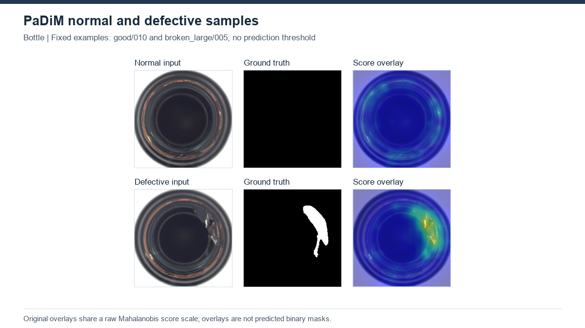

# PaDiM — Patch Distribution Modeling

[Project overview](../../README.md) · [Method index](../README.md) · [Research findings](../../docs/research_findings.md)

**Status: completed, 15 MVTec AD categories.** Results describe the recorded local implementation, not an exact paper reproduction.

## How it works

PaDiM fits a multivariate Gaussian to normal feature vectors at each spatial location. A test feature is scored by its Mahalanobis distance to that location’s normal distribution. The pretrained backbone is frozen; fitting Gaussian statistics is not gradient-based network training.

**Architecture:** Image → frozen WR50 layer1/2/3 features → aligned concatenation → fixed random550 channels → per-location mean/covariance → Mahalanobis map → bicubic interpolation and Gaussian smoothing.

## Our experiment

ImageNet1K_V1 WR50; 550 of 1792 channels; seed 1024; sample covariance+0.01I; batch 32; RGB bicubic256/center224; nearest GT; map sigma 4. Image score=max(final map). No test-selected threshold or test-minmax scaling in the controlled baseline. Independent normal holdout pilots are separate runs.

[Configuration evidence](../../experiments/padim/config_summary.json) · [Category results](../../results/benchmarks/padim/results.csv)

## Results and what we learned

All 15 categories: Image AUROC 95.40%, Pixel AUROC 97.31%, exact AUPRO@0.30 92.25%. Screw has baseline Image AUROC 84.85% despite Pixel AUROC 98.34%, showing that image ranking and pixel ranking answer different questions.

The Screw holdout pilot detected48 of 119 defective images at the recorded image threshold(71 misses,2 false alarms among41 normal images). The baseline AUROC therefore cannot be interpreted as operational recall. q99.9 improves some pixel precision/false-alarm measures relative to q99.5 but reduces recall; it is a declared sensitivity analysis, not a test-selected replacement. Position-specific modeling makes alignment a relevant design consideration, not a proven cause of these errors.

## Visual evidence

Fixed-seed normal and defective Bottle examples: input, GT and raw Mahalanobis heatmap. No baseline binary prediction mask was produced here; do not read heatmap colors as thresholded decisions.

[Visual conventions and provenance](../../docs/visual_examples.md).

## Upstream and local work

[Original implementation](https://github.com/xiahaifeng1995/PaDiM-Anomaly-Detection-Localization-master) · [Paper](https://arxiv.org/abs/2011.08785) · [Recorded provenance](upstream.json) · [Local changes](CHANGES.md).

Upstream model design is credited to its authors. Our contribution is the documented execution, adaptation and/or evaluation analysis described above. See the [protocol definitions](../../docs/evaluation_protocols.md) before cross-method comparisons. Relocated training/inference has not been verified.
