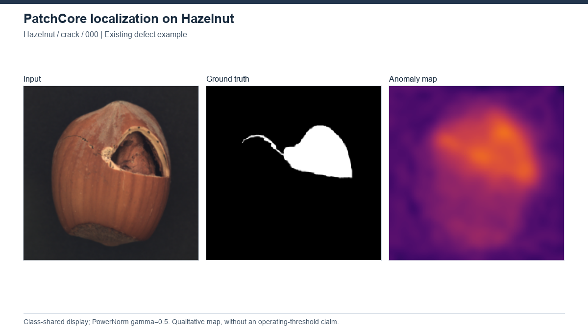

# PatchCore

[Project overview](../../README.md) · [Method index](../README.md) · [Research findings](../../docs/research_findings.md)

**Status: completed, 15 MVTec AD categories.** Results describe the recorded local implementation, not an exact paper reproduction.

## How it works

Normality is represented by a memory bank of pretrained patch features. A test patch receives a high anomaly score when its closest stored normal feature is far away. This avoids training a reconstruction network on the target category.

**Architecture:** Image → frozen Wide-ResNet50-2 layer2/layer3 features → local patch embeddings → representative memory bank → nearest-neighbor distances → anomaly map and image score.

## Our experiment

The recorded all-category run is IM224_WR50_L2-3_P01_D1024-1024_PS-3_AN-1_S0_ALL15. The evaluation uses resize256/center224. The local AUPRO extension uses200 thresholds and an interpolated FPR 0.30 endpoint. The exact coreset fraction and complete historical fitting command have not been independently recovered; the folder name is not sufficient evidence.

[Configuration evidence](../../experiments/configurations.json) · [Category results](../../results/benchmarks/patchcore/patchcore_final_results.csv)

## Results and what we learned

All 15 categories have results: Image AUROC 99.18%, Pixel AUROC 98.11%, local AUPRO 93.00%. These are category macro averages under the PatchCore evaluator, not common-evaluator measurements.

The stored features provide a strong recorded ranking reference without target-category gradient training. However, memory-bank/search cost remains relevant. Wood and Tile have lower pixel ranking scores than several other categories; this is not proof of a specific failure mechanism. A shared threshold-calibration or matched timing study against the other methods is not available.

## Visual evidence

Hazelnut crack/000. Input / GT / map; class-shared PowerNorm display. [All-method gallery](../../assets/GALLERY.md) and [figure provenance](../../assets/figures/SOURCES.csv) identify the original source, selection and scale. This illustration is not a matched-protocol comparison.

## Upstream and local work

[Original implementation](https://github.com/amazon-science/patchcore-inspection) · [Paper](https://arxiv.org/abs/2106.08265) · [Recorded provenance](upstream.json) · [Local changes](CHANGES.md).

Upstream model design is credited to its authors. Our contribution is the documented execution, adaptation and/or evaluation analysis described above. See the [protocol definitions](../../docs/evaluation_protocols.md) before cross-method comparisons. Relocated training/inference has not been verified.
