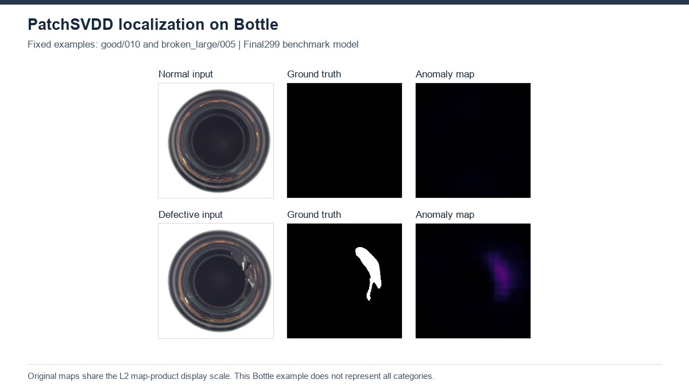

# PatchSVDD

[Project overview](../../README.md) · [Method index](../README.md)

**Status: completed benchmark, 15/15 MVTec AD categories.** Evidence snapshot: 2026-10-22T10:50:46+03:00.

## Principle and architecture

Patch encoders learn normal local representations with compactness and a relative-position classification objective. Two patch scales produce nearest-normal distances; overlapping scores are combined into the image map.

## Recorded setup

299 training passes; D64; lambda 0.001; seed 1024; batch 64; full-bank exact float32 L2 instead of NGT/KDTree; nearest256GT. No best-test selection.

[Configuration/evidence](../../results/incomplete/patchsvdd_bottle/protocol.json).

## Outcomes and limitations

All 15 categories have final evaluation records for the 299-pass main experiment (lambda 0.001). The category CSV agrees with each metrics.json, and the equal-category macro agrees with summary.json: **80.336 / 91.160 / 68.606%**, image AUROC / pixel AUROC / AUPRO@0.30.

| Category | Image AUROC (%) | Pixel AUROC (%) | AUPRO@0.30 (%) |
|---|---:|---:|---:|
| bottle | 99.365 | 97.731 | 87.960 |
| cable | 84.633 | 92.065 | 75.376 |
| capsule | 66.334 | 81.469 | 48.216 |
| carpet | 58.266 | 78.227 | 23.112 |
| grid | 93.818 | 93.289 | 80.781 |
| hazelnut | 81.679 | 96.851 | 89.476 |
| leather | 83.730 | 96.088 | 80.668 |
| metal_nut | 93.988 | 98.201 | 79.610 |
| pill | 78.260 | 92.414 | 67.038 |
| screw | 4.489 | 68.937 | 16.896 |
| tile | 94.444 | 94.597 | 80.913 |
| toothbrush | 87.778 | 96.600 | 75.227 |
| transistor | 93.625 | 97.039 | 85.332 |
| wood | 92.456 | 89.002 | 58.041 |
| zipper | 92.174 | 94.891 | 80.449 |

This is a single-seed local implementation with exact full-bank float32 L2 matching, not a verified paper reproduction or a matched-protocol leaderboard. The completed Carpet lambda=0.1 and 0.01 diagnostic runs are separate from this main table; their results are not substituted for the fixed-lambda main run. Random/pretrained feature comparisons and numerical root-cause probes are diagnostic evaluations, not additional main benchmarks.

Source records (workspace-relative, outside github_release): PatchSVDD_MVTec_all15_20261012/results.csv, summary.json, status.json and per-category metrics.json/status.json; Bottle is reused from PatchSVDD_Bottle_20261012. The CSV SHA-256 at this snapshot is 18f617920384a0264b2551f7db258177d268205f2ec3293def6effe5f43e1d3d. [Reconciliation evidence](../RECONCILIATION_EVIDENCE.csv) preserves the earlier inspected records. Full external outputs have not been repackaged by this documentation change.

## Historical experiments

**Status: partial benchmark (5/15 at capture).**

### 13 October 2026 release snapshot

The preserved release snapshot is5/15 complete, not a current live status. Bottle: Image AUROC 99.37%, Pixel AUROC 97.73%, exact AUPRO 87.96%. Results for Cable, Capsule, Carpet and Grid are also retained; their partial macro must not be presented as an all 15 benchmark. Bottle hyperparameters were held fixed across categories, not tuned per category.

[Recorded status/results](../../results/incomplete/patchsvdd/results.csv).

## Sources and local work

[Original source](https://github.com/nuclearboy95/Anomaly-Detection-PatchSVDD-PyTorch) · [Provenance](upstream.json) · [Local changes](CHANGES.md).

[Paper](https://arxiv.org/abs/2006.16067).

## Existing Bottle panel

Fixed-seed examples; no binary prediction mask. This is a completed Bottle output, not evidence of full benchmark completion.

No new experiment was run for this documentation. Relocated execution is unverified.
