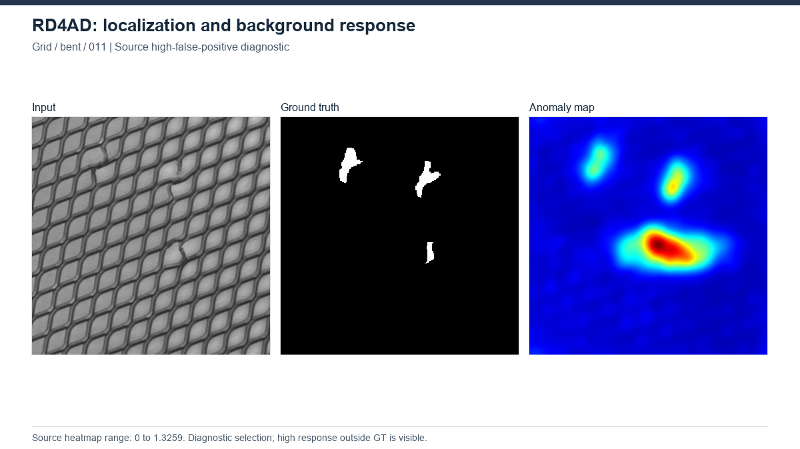

# RD4AD — Reverse Distillation

[Project overview](../../README.md) · [Method index](../README.md) · [Research findings](../../docs/research_findings.md)

**Status: completed, 15 MVTec AD categories.** Results describe the recorded local implementation, not an exact paper reproduction.

## How it works

A pretrained teacher encodes an image into multiscale features. A trainable one-class bottleneck and student decoder learn to reconstruct the teacher features of normal images. At test time, teacher–student disagreement indicates a possible defect.

**Architecture:** Image → frozen pretrained WR50 teacher encoder → one-class bottleneck embedding(OCBE) → student decoder → multiscale cosine-discrepancy maps → aggregation and smoothing.

## Our experiment

256×256; Wide-ResNet50-2 teacher and de_wide_resnet50_2 student; official cosine loss; Adam 0.005, betas(0.5,0.999); batch 16; 200 epochs; seed 111. Final200 checkpoint, not best-test selection. Bottle records periodic test evaluation; that is different from claiming no training-time test access. The held-out pilot uses its separately documented access policy.

[Configuration evidence](../../experiments/configurations.json) · [Category results](../../results/benchmarks/rd4ad/all15_results.csv)

## Results and what we learned

All 15 categories: Image AUROC 98.36%, Pixel AUROC 97.79%, repo AUPRO 93.94%. Repo AUPRO averages per-image PRO integrals. Shared-evaluator AUPRO is93.6802%, a distinct result.

Strong ranking did not transfer automatically to the training-normal threshold. In the common study, RD4AD has macro recall 96.00% but FPR 57.79% and F1 15.04%. Held-out normals helped Transistor threshold transfer, with a recall trade-off. Grid performance deteriorated after 80%-data retraining; changing its threshold did not repair the weak ranking.

## Visual evidence

Grid bent/011. Input / GT / map; explicitly selected high-FP case. [All-method gallery](../../assets/GALLERY.md) and [figure provenance](../../assets/figures/SOURCES.csv) identify the original source, selection and scale. This illustration is not a matched-protocol comparison.

## Upstream and local work

[Original implementation](https://github.com/hq-deng/RD4AD) · [Paper](https://arxiv.org/abs/2201.10703) · [Recorded provenance](upstream.json) · [Local changes](CHANGES.md).

Upstream model design is credited to its authors. Our contribution is the documented execution, adaptation and/or evaluation analysis described above. See the [protocol definitions](../../docs/evaluation_protocols.md) before cross-method comparisons. Relocated training/inference has not been verified.
