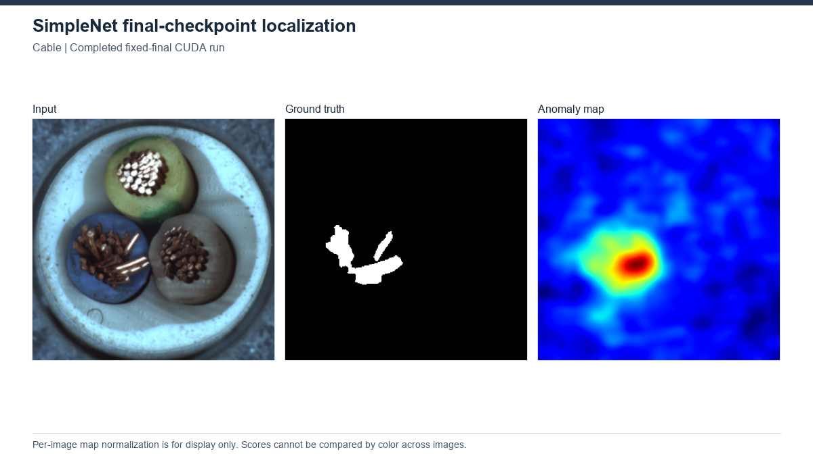

# SimpleNet

[Project overview](../../README.md) · [Method index](../README.md)

**Status: completed benchmark, 15/15 MVTec AD categories in the 20 October run.** Evidence snapshot: 2026-10-22T10:50:46+03:00.

## Principle and architecture

A frozen pretrained feature encoder feeds a feature adaptation/projection and discriminator. Gaussian perturbations supply synthetic feature anomalies during training; discriminator responses give anomaly scores.

## Recorded setup

The 20 October run uses the recorded SimpleNet revision 351a2b8d4e8cfc944dbccbf9bc6ceda930c6f26b. It fits each MVTec AD category using train/good only, without a validation holdout: frozen WideResNet50-2 layer2/layer3 features, resize 329 / center crop 288, batch 8, seed 0, 40 discriminator-training calls with four GAN epochs each, CUDA, and two loader workers. The final checkpoint is saved and reloaded for evaluation.

[Recorded source](../../third_party/records/simplenet_20261020/upstream.json), [local runner](../../third_party/local_changes/simplenet_supersimplenet_20261020/experiment.py), [source catalog](../../third_party/SOURCES.csv), [protocol notes](../../third_party/records/simplenet_supersimplenet_20261020/REPRODUCE.md), and [MIT license](../../third_party/licenses/simplenet/LICENSE).

## Outcomes and limitations

All 15 category metrics match the main results CSV and have complete statuses. Equal-category macro values agree with the recorded simplenet_mean.json: **98.429 / 96.046 / 89.256%**, image AUROC / pixel AUROC / AUPRO@0.30.

| Category | Image AUROC (%) | Pixel AUROC (%) | AUPRO@0.30 (%) |
|---|---:|---:|---:|
| bottle | 99.921 | 98.031 | 91.207 |
| cable | 99.738 | 97.343 | 89.347 |
| capsule | 97.168 | 98.783 | 93.037 |
| carpet | 98.274 | 97.251 | 89.704 |
| grid | 98.496 | 98.774 | 94.931 |
| hazelnut | 99.179 | 97.874 | 92.596 |
| leather | 100.000 | 98.825 | 96.103 |
| metal_nut | 99.756 | 98.507 | 90.823 |
| pill | 98.254 | 98.299 | 93.753 |
| screw | 97.438 | 99.153 | 95.926 |
| tile | 89.502 | 70.733 | 50.368 |
| toothbrush | 99.444 | 98.567 | 88.923 |
| transistor | 99.750 | 96.257 | 92.538 |
| wood | 99.825 | 93.377 | 84.045 |
| zipper | 99.685 | 98.910 | 95.547 |

The newer local runner bypasses the upstream high-level train() loop and evaluates the fixed final checkpoint. The retained upstream loop and older CPU runner select using test image AUROC, with pixel AUROC as a tie-breaker; those best-test results would be test-dependent. The newer protocol must not be described as a change to the original upstream training routine.

The evaluator uses native SimpleNet scores and a separate exact AUPRO@0.30 implementation, with 8-connected regions and global background FPR. No decision threshold is fitted. Crop/preprocessing and AUPRO definitions differ from other method studies and some paper comparisons. One seed does not establish uncertainty, superiority or successful paper reproduction.

Sources (workspace-relative, outside github_release): SimpleNet_MVTec_results_20261020/results.csv and category metrics.json; SimpleNet_MVTec_training_20261020/<category>/config.json and status.json; reports/simplenet_supersimplenet_20261020/simplenet_mean.json. The results CSV SHA-256 at capture is 661b6a28919a57a024abc785582cd473fa9164eb91ff7e2653c8f48d1cf59ed0. [Reconciliation evidence](../RECONCILIATION_EVIDENCE.csv) retains the earlier inspected paths/hashes. The original outputs remain outside the publication folder.

## Historical experiments

### CPU attempt preserved in the 13 October release

**Status: stopped (0/15 completed).**

### Older CPU run: setup

WR50 layer2/3; resize329/crop288; batch 8; 40 meta epochs planned; seed 0; CPU. Official selection uses test metrics.

[Configuration/evidence](../../results/incomplete/simplenet/config.json).

### Older CPU run: interruption and limits

Stopped by the user during Screw at meta-epoch8; 0 completed categories. No final AUROC/PRO result or final segmentation panel is claimed. The interruption is not evidence that the architecture is intrinsically ineffective.

[Recorded status/results](../../results/incomplete/simplenet/status.json).

## Sources and local work

The provenance and changes links below describe the older working copy; the newer revision and runner are identified above.

[Original source](https://github.com/DonaldRR/SimpleNet) · [Provenance](upstream.json) · [Local changes](CHANGES.md).

[Paper](https://arxiv.org/abs/2303.15140).

No new experiment was run for this documentation. Relocated execution is unverified.

## Visual evidence

Cable. Input / GT / map from completed fixed-final CUDA run. [All-method gallery](../../assets/GALLERY.md) and [figure provenance](../../assets/figures/SOURCES.csv) identify the original source, selection and scale. This illustration is not a matched-protocol comparison.

