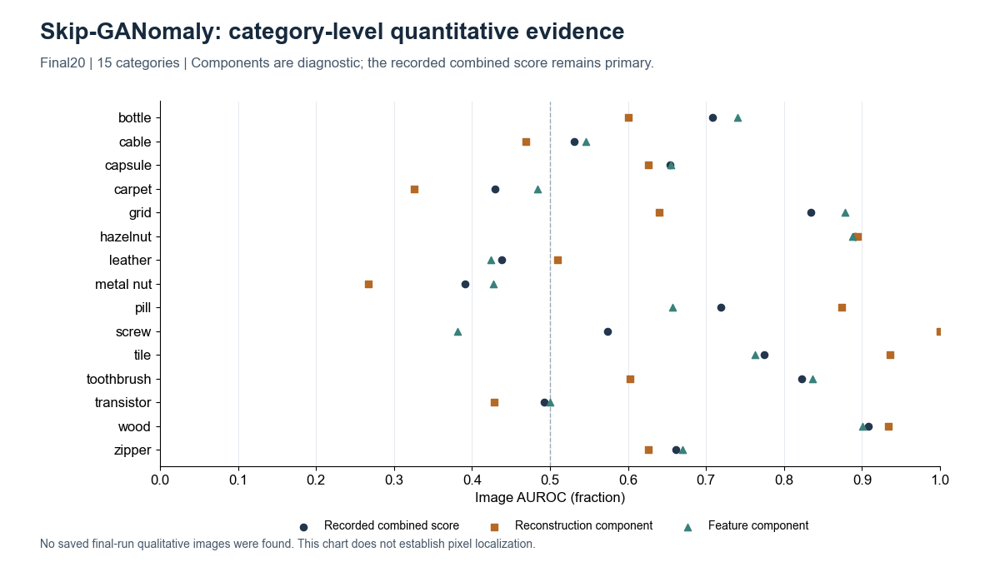

# Skip-GANomaly

[Project overview](../../README.md) · [Method index](../README.md) · [Research findings](../../docs/research_findings.md)

**Status: completed, 15 MVTec AD categories.** Results describe the recorded local implementation, not an exact paper reproduction.

## How it works

Skip-GANomaly uses a skip-connected encoder–decoder generator and an adversarial discriminator. The recorded inference score combines image reconstruction error and discriminator-feature discrepancy. Skip connections alone do not guarantee an anomaly-sensitive score.

**Architecture:** Image → U-Net-style generator with skip connections → reconstruction. The discriminator supplies adversarial predictions and feature representations; the implemented score combines 0.9×pixel MSE and 0.1×feature MSE.

## Our experiment

15 categories; 20 epochs each; seed 0; 256 px; batch 8; CPU; Adam lr 0.0002. Fixed final checkpoint followed by one evaluation. The local audit corrected graph/BatchNorm and visualization side effects while retaining the recorded architecture/objectives and score direction.

[Configuration evidence](../../results/benchmarks/skip_ganomaly/bottle/train/opt.txt) · [Category results](../../results/benchmarks/skip_ganomaly/skipganomaly_mvtec15_results.csv)

## Results and what we learned

Macro raw Image AUROC 65.52%; reconstruction component64.88%; latent component65.01%. Wood 90.79% and Metal Nut 39.15% show substantial category variation. No validated native pixel benchmark is available.

The earlier one-epoch Bottle audit isolated an AUROC change caused by BN buffers rather than learned-parameter changes. It also found train/eval feature-scale mismatch and residuals dominated by image energy. Those smoke diagnostics must not be generalized as a proven causal explanation of every 20 epoch result. Neither score inversion nor choosing a favorable component after seeing test scores is reported as the primary result.

## Visual evidence

All15. Quantitative category chart only; no saved final-run qualitative images found. [All-method gallery](../../assets/GALLERY.md) and [figure provenance](../../assets/figures/SOURCES.csv) identify the original source, selection and scale. This illustration is not a matched-protocol comparison.

## Upstream and local work

[Original implementation](https://github.com/samet-akcay/skip-ganomaly) · [Paper](https://arxiv.org/abs/1901.08954) · [Recorded provenance](upstream.json) · [Local changes](CHANGES.md).

Upstream model design is credited to its authors. Our contribution is the documented execution, adaptation and/or evaluation analysis described above. See the [protocol definitions](../../docs/evaluation_protocols.md) before cross-method comparisons. Relocated training/inference has not been verified.
