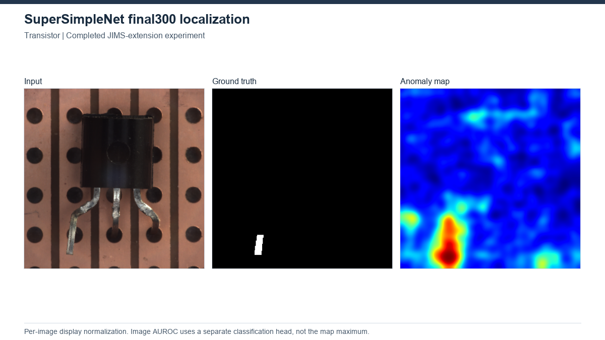
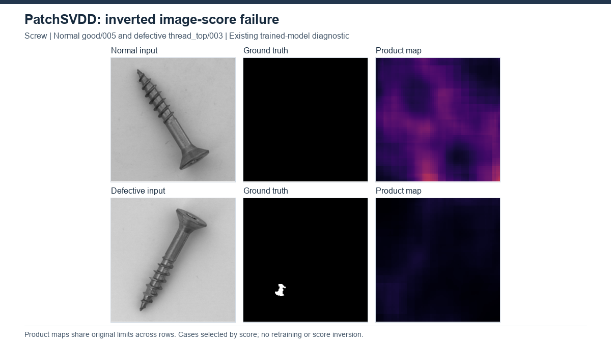

# Results

Verified 23 October 2026. Eleven methods completed category-wise MVTec AD evaluation (15/15 categories each). These are local single-seed results, not successful paper-reproduction claims. Rows follow the project method order; preprocessing, selection and PRO/AUPRO definitions differ, so this is not a directly comparable leaderboard.

## Completed benchmarks

Equal-category macro averages in percent; CSV retains original fractions and full precision. PRO/AUPRO entries use the row's recorded evaluator, not a common metric implementation.

| Method | Image AUROC | Pixel AUROC | Recorded PRO/AUPRO | Protocol |
|---|---:|---:|---:|---|
| [PatchCore](benchmarks/patchcore/patchcore_final_results.csv) | 99.180 | 98.111 | 93.004 | patchcore_200_thresholds |
| [DFR](benchmarks/dfr/dfr_all_results.csv) | 93.854 | 95.251 | 89.943 | dfr_native_pro |
| [RD4AD](benchmarks/rd4ad/all15_results.csv) | 98.357 | 97.789 | 93.941 | rd4ad_per_image_pro |
| [PaDiM](benchmarks/padim/results.csv) | 95.402 | 97.310 | 92.246 | padim_exact_030 |
| [AnoGAN adaptation](benchmarks/anogan/results.csv) | n/a | 76.354 | n/a | anogan_native_threshold |
| [GANomaly official-flow](benchmarks/ganomaly/results.csv) | 57.621 | n/a | n/a | ganomaly_train_mode_final |
| [Skip-GANomaly](benchmarks/skip_ganomaly/skipganomaly_mvtec15_results.csv) | 65.516 | n/a | n/a | skip_final_eval |
| [PatchSVDD](benchmarks/patchsvdd/results.csv) | 80.336 | 91.160 | 68.606 | patchsvdd_exact_030 |
| [SimpleNet](benchmarks/simplenet/results.csv) | 98.429 | 96.046 | 89.256 | simplenet_fixed_final_exact_030 |
| [SuperSimpleNet (JIMS)](benchmarks/supersimplenet/results.csv) | 98.305 | 97.521 | 91.193 | supersimplenet_fixed_final_exact_030 |
| [DRAEM](benchmarks/draem/results.csv) | 97.597 | 97.134 | 92.506 | draem_final700_exact_030 |

[Machine-readable summary](summary.csv) | [Protocol definitions](PROTOCOLS.md) | [Additional studies](ADDITIONAL_STUDIES.md) | [Input provenance](SOURCES.csv)

Primary category CSVs retain additional recorded metrics, including AP, anomaly-only pixel AUROC, thresholded correctness, component-score AUROC and oracle F1 where available. These columns keep their original names. Aggregate rows and absolute workstation prefixes were removed from publication tables; original measurements are unchanged and archived. Paper-reference columns are not local results.

**GANomaly:** the image AUROC above is final25; its best-test macro is 69.171%, separately preserved in summary.csv and the category table. Both inherit train-mode test BatchNorm contamination. **AnoGAN:** native image AUROC is unavailable; the later max-map evaluation gives 67.542% and is [reported separately](benchmarks/anogan/image_max_results.csv).

## Selected scientific figures

Illustrative examples selected from existing outputs. Heatmap scales, diagnostic selection and absent masks are explicit; different protocols remain distinct. [Gallery: all11 methods](../assets/GALLERY.md) | [Figure provenance](../assets/figures/SOURCES.csv).

**Threshold transfer:** DFR/RD4AD on the same Leather image. Independently scaled maps; recorded normal-training thresholds. [Matched-evaluator findings](common_evaluation/report.md).

**Texture localization:** DRAEM final700 on Grid/glue/007, retaining the recorded GT and preprocessing conventions.

**Object localization:** SuperSimpleNet final300 on Transistor. Per-image display normalization; image scoring uses a separate head.

**Failure:** PatchSVDD Screw score-selected extremes. Normal and defective product maps share the original display range; these are diagnostic selections, not random examples.

## Evidence gaps and publication limits

- No native pixel benchmark/AUPRO is verified for GANomaly or Skip-GANomaly; AnoGAN has no native image AUROC/AUPRO. Blank cells are retained.
- Native DFR/RD4AD PRO and local exact/approximate AUPRO differ. Category macros cannot repair mismatched protocols.
- Full reproduction remains unverified: some historical source/configuration details and PatchCore coreset settings are missing; the deleted historical AE metrics cannot be recovered.
- The experiment registry and method evidence still include external workspace paths. The latest benchmark category tables are bundled here, but those external references were not rewritten outside this task. Method configuration links now point to the retained consolidated settings.
- Historical incomplete/ files survive solely for existing method references. They do not override current benchmark results. The root README/release manifests may still describe older snapshots.
- All former results/assets files are preserved outside GitHub under publication_archive/results_assets_20261023; original training/evaluation records elsewhere are unchanged. No experiments were rerun.
